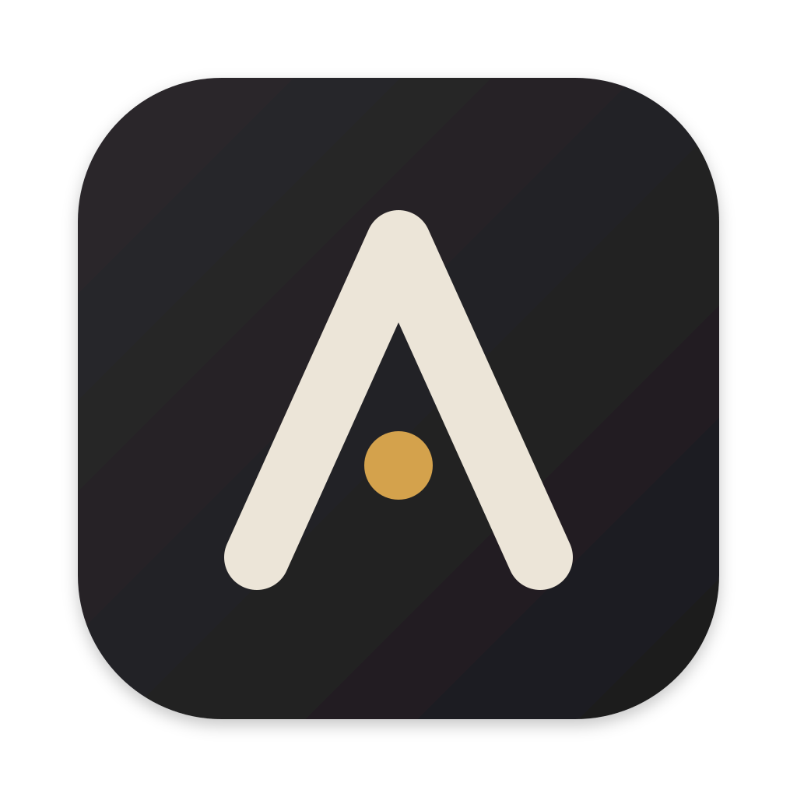

<p align="center">
  
</p>

<h1 align="center">Alexandria</h1>

<p align="center">Turn any PDF book into key data, structured notes and tests — read once by Claude, studied offline.</p>

---

Alexandria is a macOS desktop app. Drop in a PDF and Claude reads it **once**, producing:

- **Key data** for every section: concepts, definitions, facts, figures and quotes with page references
- **Structured notes** for every section, plus a whole-book overview, glossary and key takeaways
- **A question bank** of multiple choice, true/false and open questions

After that, reading notes and taking tests is completely offline: no AI calls and no tokens spent. Tests
adapt to your weak spots and track mastery per chapter. Everything is stored as plain files and a SQLite
database in `~/.alexandria`.

## Install

```sh
git clone <repository-url>
cd alexandria
./scripts/install.sh --open
```

The script works on a fresh Mac: it uses your Node.js and Rust if present, and otherwise downloads private
copies into the repository. It installs to `/Applications/Alexandria.app`, and re-running it updates the app
without touching your data. Update, reset and uninstall are also available in **Settings → Maintenance**.

On first launch Alexandria helps you install and sign in to [Claude Code](https://docs.claude.com/en/docs/claude-code/setup),
which it uses to read your books.

## Documentation

See [`docs/`](docs/README.md):
[installation](docs/installation.md) ·
[architecture](docs/architecture.md) ·
[book parsing](docs/book-parsing.md) ·
[tests & grading](docs/tests-and-grading.md) ·
[data storage](docs/data-storage.md) ·
[Claude connection](docs/claude-connection.md) ·
[user interface](docs/user-interface.md) ·
[development](docs/development.md)

## Tech

[Tauri 2](https://tauri.app) (Rust) · React 19 · TypeScript · styled-components · pdf.js · SQLite · Claude Code
