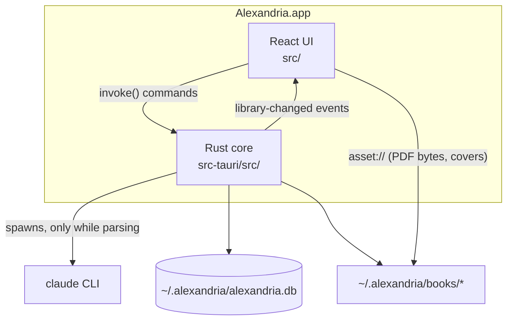
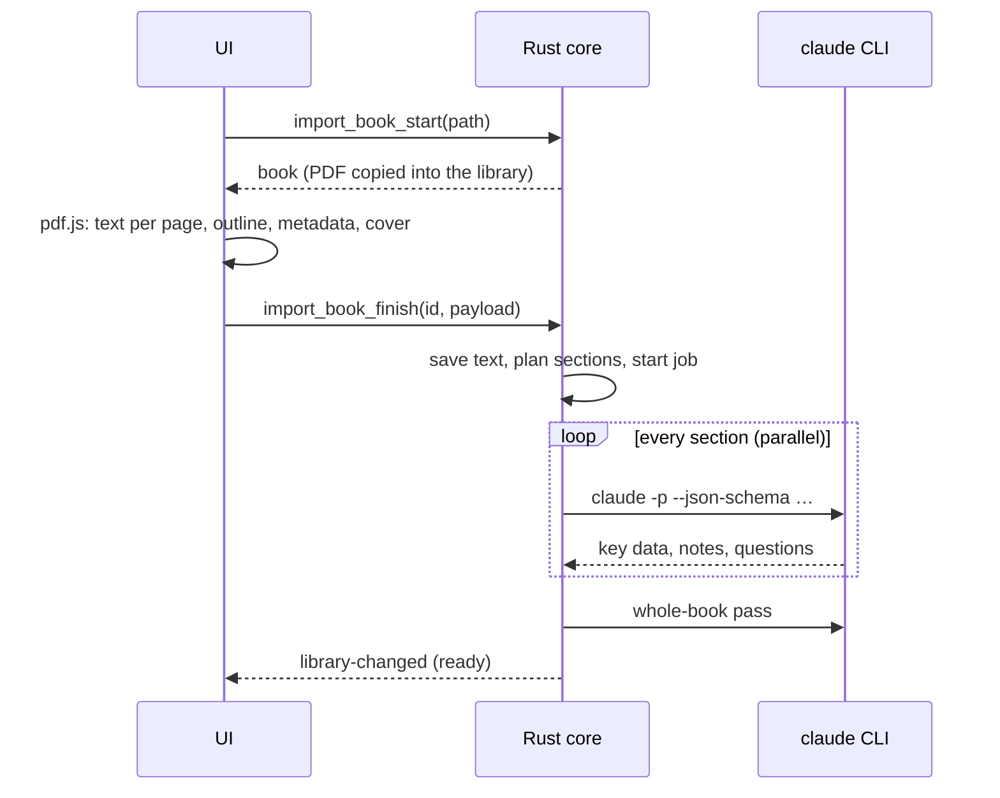

# Architecture

Alexandria is a [Tauri 2](https://tauri.app) app: a small native Rust process that owns a macOS window
(WKWebView) in which a React UI runs. There is no server and no network service of our own.



## Responsibilities

**Rust core** (`src-tauri/src`) — everything that touches the system:

- finding and running the `claude` CLI, and the setup checks
- the one-time parsing job (background tasks, concurrency, resume after pause or crash)
- the SQLite database and all files in `~/.alexandria`
- tests: selecting questions, saving answers, grading, statistics, markdown exports
- maintenance (update / reset / uninstall)

**React UI** (`src`) — everything the user sees, plus PDF text extraction with pdf.js. Extraction runs in
the web view because pdf.js is the most robust PDF text extractor available and needs no native libraries.

The UI calls the core only through the typed wrappers in `src/services/tauri-bridge/commands.ts`, which mirror
the Rust commands in `src-tauri/src/commands/` one to one. The core notifies the UI about changes with a single event,
`library-changed` (payload: book id); screens reload what they show when it fires.

## Importing a book



Details: [Book parsing](book-parsing.md).

## Project layout

```text
alexandria/
├── docs/                         documentation (you are here)
├── scripts/
│   ├── install.sh                build + install / update into /Applications
│   └── maintenance.sh            update, reset, uninstall (also bundled in the app)
├── src/                          React UI (TypeScript, styled-components)
│   ├── main.tsx                  entry point
│   ├── app/                      the app itself
│   │   ├── App.tsx               root: settings, theme, Claude setup gate
│   │   ├── AppShell.tsx          sidebar + current screen + drop overlay
│   │   ├── state/                React contexts: navigation, imports
│   │   └── theme/                design tokens and global styles (light/dark)
│   ├── components/               reusable UI
│   │   ├── ui-kit/               styled primitives: buttons, forms, layout, text, feedback, cover
│   │   ├── markdown-reader/      markdown rendering, document reader, table of contents
│   │   └── sidebar/              app navigation
│   ├── screens/                  one folder per screen
│   │   ├── book-detail/          book header + Overview / Tests tabs
│   │   ├── claude-setup/         first-run setup
│   │   ├── library/              library grid and imports
│   │   ├── settings/             settings and maintenance
│   │   └── test-session/         test runner and results
│   ├── hooks/                    React hooks (one per PascalCase .tsx file)
│   ├── services/                 talking to the outside world
│   │   ├── tauri-bridge/         typed commands, shared types, event names
│   │   └── pdf-import/           pdf.js extraction
│   ├── utils/                    pure helpers (formatting, scrolling)
│   └── resources/                app icon (source of all icon sizes)
├── src-tauri/                    Rust core (Tauri)
│   ├── src/                      module folders, see below
│   ├── capabilities/             permissions granted to the window
│   ├── icons/                    generated app icons
│   └── tauri.conf.json           window, bundle and security configuration
└── tests/
    ├── backend/                  Rust integration tests, mirroring src-tauri/src
    └── frontend/                 Vitest tests, mirroring src
```

### Rust modules

```text
src-tauri/src/
├── main.rs, lib.rs       entry point, app setup, command registration
├── app/                  state.rs (shared state, events) · error.rs (errors returned to the UI)
├── commands/             Tauri commands, one file per area: claude · library · study · system
├── storage/              db.rs (SQLite + migrations) · paths.rs (~/.alexandria) · settings.rs
├── claude/               cli.rs (find and run `claude`) · prompts.rs (prompts and JSON schemas)
├── library/              books.rs · import.rs · documents.rs (markdown files) · sections.rs (splitting)
├── parsing/              pipeline.rs (the one-time parsing job)
├── study/                questions.rs · attempts.rs (tests, grading) · mastery.rs (stats) · exports.rs
└── system/               terminal.rs (Claude sign-in in Terminal) · maintenance.rs (background update/reset/uninstall)
```

Commands stay thin: they validate input, call the domain modules and notify the UI. Only `library`,
`storage` and `study` are public, which is what the integration tests use.

## Security model

- The window may only call Alexandria's own commands plus the native open-file dialog, window dragging and
  theme (`src-tauri/capabilities/default.json`). There is no generic shell or filesystem access from the UI.
- The UI reads files only through the asset protocol, scoped to `~/.alexandria/**`.
- Claude runs with all tools disabled, except `Read` for scanned PDFs, where its working directory is the
  book's folder.
- The CSP allows styles inline (needed by styled-components) but no remote scripts.
