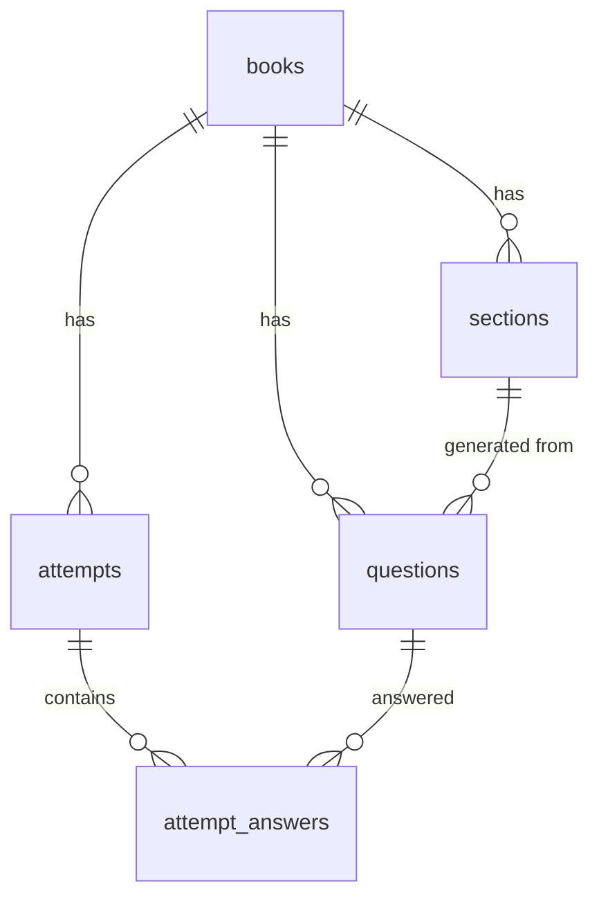

# Data storage

Everything Alexandria stores lives in **`~/.alexandria`**. Set `ALEXANDRIA_HOME` to use another folder, for
example during development. Reset deletes this folder; see [Installation & maintenance](installation.md).

```text
~/.alexandria/
├── alexandria.db                SQLite database (WAL mode)
├── run/                         short-lived Terminal scripts (sign-in, Claude Code install)
└── books/
    └── <title-slug>-<id6>/      one folder per book
        ├── book.pdf             copy of the original PDF (Save PDF in the book header exports it)
        ├── cover.jpg            first page thumbnail
        ├── source/
        │   ├── pages.json       extracted text, one string per page
        │   └── outline.json     table of contents [{ title, page }]
        ├── key-data/
        │   └── 001-<section>.md most important data, one file per section
        ├── notes/
        │   ├── 000-overview.md  whole-book overview
        │   ├── 001-<section>.md structured notes per section
        │   ├── 900-glossary.md
        │   └── 901-key-takeaways.md
        ├── tests/
        │   └── question-bank.md every question with answers and explanations
        └── results/
            └── <date>-<id>.md   one file per finished test
```

Markdown files are the source of truth for notes and key data; the app reads them directly, so you can open,
search or back them up with any tool. File prefixes keep the order: `000` and `9xx` are whole-book documents,
the others follow the book's sections.

## Database

The database holds what needs querying: books, sections, the question bank, test attempts and settings.
Migrations live in `src-tauri/src/storage/db.rs` and are applied on startup (tracked with `PRAGMA user_version`).
Never edit a shipped migration; append a new one.



| Table | Purpose | Key columns |
| --- | --- | --- |
| `books` | one row per book | `status`, `stage`, `error`, `summary`, `cost_usd`, `dir_name` |
| `sections` | planned sections and their parse state | `idx`, `start_page`, `end_page`, `mode` (`text`/`vision`), `status`, `file_stem`, `placeholder` |
| `questions` | the question bank | `section_id` (NULL = whole-book), `kind`, `difficulty`, `options` (JSON), `answer`, `explanation` |
| `attempts` | tests | `status` (`in_progress`/`review`/`graded`), `scope` (JSON), `score` |
| `attempt_answers` | one row per question in a test | `position`, `response`, `score` (NULL = not graded yet) |
| `claude_usage` | latest 5-hour and weekly plan usage reported by Claude (one row) | `five_hour`, `five_hour_resets_at`, `seven_day`, `seven_day_resets_at` |
| `settings` | key/value JSON settings | `theme`, `model`, `concurrency`, `questionsPerSection`, `bookQuestions`, `claudePath`, `sidebarHidden`, `maxCostUsd`, `palette`, `font` |

Deleting a book removes its rows (cascading) and its folder.
